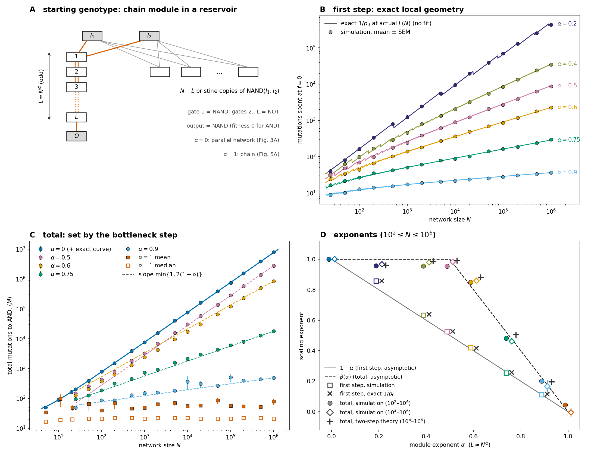

# bottleneck_replication

Replication of the bottleneck note (*Mutational target size and the bottleneck principle*) with two engines, and an extension of its Fig. 2 to N = 10⁶.

## Contents

| file | what |
|---|---|
| `starts.py` | Starting genotypes: parallel, chain, chain-in-reservoir (L ≃ N^α), bottleneck state T_k |
| `theory.py` | Exact Eq. 3 (⟨M⟩ from the parallel start) and Eq. 4 (1/p₀). Brute-force enumerator of p_σ. Exact O(16L) enumerator for chain-in-reservoir and T_k states (agrees with brute force to 1e-11). |
| `run_sims.py`, `analyze.py` | `faster_circuit` vs `fast_circuit` up to N = 10⁴ → `results/`, `tables.md`, `fig_endpoints.png`, `fig_interpolating.png` |
| `run_1e6.py`, `fig_1e6.py` | `faster_circuit` up to N = 10⁶ → `results_1e6/`, `fig_intermediate_exponents_1e6.png` |

N_P = 10⁴, target AND. Runs per point: 1000 (α = 0), 4000 (α = 1), 1000 for the intermediate α values in the 10⁶ run.

## Results up to N = 10⁶ (faster_circuit)

- **Parallel start.** ⟨M⟩ matches exact Eq. 3 at all 18 sizes from N = 5 to 10⁶ (χ² = 18.5 on 18 points).
- **First step.** The mean number of mutations at f = 0 sits on the exact 1/p₀ curve at the actual L(N) for every α up to 10⁶. This includes the jumps where L moves to the next odd integer.
- **Exponents** (weighted least-squares fits of ln⟨M⟩ on ln N):

| α | 1−α | first step, sim | first step, exact | β(α) | total, 10²–10⁶ | total, 10⁴–10⁶ | two-step theory, 10⁴–10⁶ |
|---|---|---|---|---|---|---|---|
| 0 | 1 | – | – | 1 | 1.000 ± 0.002 | 1.003 ± 0.006 | – |
| 0.2 | 0.8 | 0.857 ± 0.003 | 0.859 | 1 | 0.957 ± 0.003 | 0.968 ± 0.007 | 0.959 |
| 0.4 | 0.6 | 0.634 ± 0.003 | 0.639 | 1 | 0.956 ± 0.003 | 0.981 ± 0.007 | 0.985 |
| 0.5 | 0.5 | 0.524 ± 0.003 | 0.526 | 1 | 0.955 ± 0.003 | 0.984 ± 0.007 | 0.991 |
| 0.6 | 0.4 | 0.421 ± 0.003 | 0.416 | 0.8 | 0.849 ± 0.003 | 0.859 ± 0.008 | 0.882 |
| 0.75 | 0.25 | 0.254 ± 0.003 | 0.258 | 0.5 | 0.482 ± 0.004 | 0.462 ± 0.010 | 0.506 |
| 0.9 | 0.1 | 0.112 ± 0.003 | 0.116 | 0.2 | 0.200 ± 0.009 | 0.167 ± 0.041 | 0.195 |
| 1 | 0 | – | – | 0 | 0.044 ± 0.008 | −0.004 ± 0.031 | – |

**α = 0.6 crossover.** Eq. 6 has the reservoir term (~N) and the chain-internal term (~L²) cross at N_× ≈ 3×10⁴. The upper fit range straddles that point, so the measured exponent (≈ 0.86) sits between 1 and the asymptotic 0.8. The exact two-step theory gives local exponents of 0.877, 0.857, 0.840 and 0.827 per decade from 10⁶ to 10⁹. The asymptote is approached only very slowly.

## Engine comparison up to N = 10⁴ (see `tables.md`)

`results/fast_*` were generated with `fast_circuit` **before** the mutation fix in commit e48ada6. They therefore include counted no-op mutations, which inflate M by about 1/N: +24% at N = 5 and +11% at N = 10. For N ≳ 20 they agree with `faster_circuit` within statistical error. The N = 10⁴ `fast_circuit` configs were not run.
